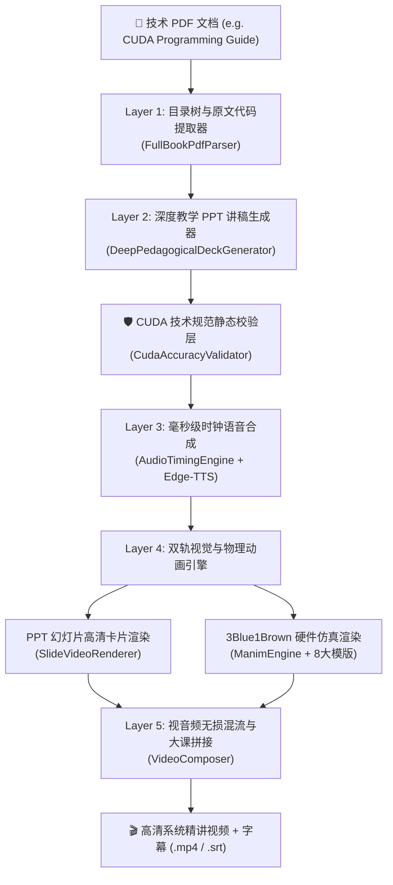

# CudaStudy: Technical PDF to High-Density Video Studio

> **Transform Complex System Technical Documentation (e.g., CUDA C++ Programming Guide) into Structured Pedagogical Lecture Slide Decks & 3Blue1Brown-style Manim Hardware Microarchitecture Simulations.**

---

## 🌟 核心特性 (Key Features)

1. **全书目录树与原文字节解析 (L1 Full-Book Dynamic Parser)**:
   - 动态递归提取 PDF 内部目录大纲（TOC）、章节层级、精确页码范围。
   - 自动消除双栏排版断行断字、去除页眉页脚干扰，智能提取原版 C++/CUDA 代码块与数学公式。

2. **深层教学型 PPT 讲稿生成 (L2 Deep Pedagogical Deck Generator)**:
   - 告别空洞泛化，依据原文真实篇幅动态生成 4 至 12 页的高信息密度 PPT（提供 Markdown 与 HTML 演示文稿预览）。
   - 每页均配备 150~300 字详尽、严密的教学级口播讲稿，并内置 **3.5 秒认知消化停顿** 机制。

3. **CUDA 技术准确性静态校验层 (CUDA Accuracy Validator)**:
   - 内置针对并发和异构计算的规则分析器：自动拦截分支内的 `__syncthreads()` 死锁隐患、全局内存索引越界、Shared Memory Bank 冲突跨步，保证讲稿与代码 100% 严谨可靠。

4. **双轨同步渲染引擎 (L3 & L4 Dual-Track Visual Engine)**:
   - **PPT 幻灯片精美卡片轨**：自动生成高对比度暗黑风格 1080P/720P 幻灯片卡片，带高亮代码框与反思缓冲条。
   - **3Blue1Brown Manim 物理微架构仿真轨**：针对硬件核心机理提供 8 大参数化稳定模版与自愈修复引擎（Self-Correction Loop）。

5. **断点续跑与秒级恢复 (Checkpoint Resume & Caching)**:
   - 每一层中间产物（Deck JSON、音频、分段视频切片）全部结构化落盘。
   - 遇到网络中断或重新生成时，自动秒级跳过已渲染素材，仅生成失败或缺失的切片。

6. **开箱即用图形化控制台 (app_gui.py / CudaVideoStudio.exe)**:
   - 基于 CustomTkinter 打造的现代化深色界面，内置一键环境体检诊断工具、画质切换、音色定制与实时日志流。

---

## 🏛️ 五层架构流水线 (Pipeline Architecture)



---

## 🎬 内置 8 大 CUDA 硬件级 Manim 仿真模版

| 编号 | 仿真主题 | 核心展示的软硬件冲突与解法 |
| :---: | :--- | :--- |
| **01** | **Global Thread Indexing** | CPU 串行线性思维 vs GPU 块与线程网格空间升维映射 (`blockIdx * blockDim + threadIdx`) |
| **02** | **Warp Divergence** | SIMT 32 线程束锁步推进 vs `if/else` 分支硬件强制串行掩码挂起 |
| **03** | **Shared Memory Bank Conflict** | 32 路 Bank 并发访问 vs 2路/多路命中同一 Bank 导致排队降速（含 Padding 对角填充解法） |
| **04** | **Coalesced Memory Access** | 128 字节总线事务对齐合并访存 vs 离散跨步访问导致的带宽暴跌（AoS 转 SoA） |
| **05** | **Atomic Operations & Race** | 多线程并发读改写导致的全局累加器数据丢失 vs 硬件互斥锁与局部规约 |
| **06** | **__syncthreads() Barrier Safety** | 块内乱序脏读防范 vs 分支内屏障导致硬件永久死锁禁忌 |
| **07** | **Tiled GEMM Matrix Multiplication** | 全局显存高延迟搬运瓶颈 vs 片上 Shared Memory 协作复用数十倍算力 |
| **08** | **CUDA Streams & Overlap** | 默认流串行阻塞 vs 多流双缓冲异步流水线（PCIe 传输与 SM 算力 100% 重叠） |

---

## 🛠️ 运行环境要求与一键体检

### 1. 基础环境
- **Python**: 3.10 或 3.11（推荐 3.11）
- **FFmpeg**: 必备视频编解码工具（项目内置自动挂载机制）
- **Edge-TTS**: 微软原生高清语音合成（无需任何付费 Key）
- **DeepSeek API Key**（可选）：用于 LLM 高阶认知提炼；若未配置，系统会自动无缝切换至内置的**确定性算法提炼引擎**。

### 2. 一键自检运行环境
在终端中执行内置的诊断脚本：
```bash
python check_env.py
```
若全部就绪，将输出如下诊断报告：
```text
===========================================================================
🚀 [CudaStudy Video Studio] 系统与运行环境诊断报告
===========================================================================
✅ [通过]   Python 解释器版本              : Python 3.11.6
✅ [通过]   FFmpeg 视频编解码器             : 就绪 -> ffmpeg.exe (v9.0.2)
✅ [通过]   Manim 物理动画引擎              : Manim Community v0.22.1
✅ [通过]   Edge-TTS 语音合成库            : edge-tts 正常加载 (zh-CN-YunxiNeural)
✅ [通过]   CUDA 官方教材 PDF             : cuda-programming-guide.pdf (11.66 MB)
===========================================================================
🎉 核心环境完备！系统随时可以启动生成课程视频。
===========================================================================
```

---

## 🚀 快速起步

### 1. 克隆与安装依赖
```bash
git clone https://github.com/maleRjc/CudaStudy.git
cd CudaStudy

# 创建并激活虚拟环境
python -m venv .venv
.venv\Scripts\activate

# 安装核心依赖
pip install manim edge-tts customtkinter pypdf av pillow requests imageio-ffmpeg
```

### 2. 启动桌面可视化控制台
```bash
python app_gui.py
```
在控制台中：
1. 点击 **"🔍 运行系统依赖体检"** 确认环境完整；
2. 选择要生成的章节切片（如 `01_global_thread_indexing` 或全书任意章节）；
3. 勾选 **"启用断点续跑"**；
4. 点击 **"🚀 一键生成 PPT 讲稿与精讲视频"**，即可自动产出 Markdown 幻灯片、HTML 网页课件及最终 MP4 视频！

### 3. 命令行静默批量批处理
直接调用全书流水线制作指定章节或全书大课：
```bash
# 制作单章节视频 (支持断点续跑)
python pipeline/full_book_orchestrator.py

# 运行 CUDA 技术规范静态校验
python pipeline/cuda_validator.py
```

---

## ❓ 常见问题排查 (FAQ)

### Q1: FFmpeg 报错 `ffmpeg not found`？
- **解答**：安装 `imageio-ffmpeg`（`pip install imageio-ffmpeg`），系统已内置自动探测逻辑，无需手动配置 Windows 环境变量即可自动挂载。

### Q2: Manim 报错 `LaTeX not found` 或公式渲染异常？
- **解答**：系统已集成自愈保护层。当环境缺失 MiKTeX 或 `dvisvgm` 时，引擎会自动将 `MathTex` 平滑降级为 Unicode 纯文本矢量排版，保障视频渲染 100% 成功不中断。

### Q3: 运行中断后需要从头开始吗？
- **解答**：不需要！勾选界面中的 **"启用断点续跑"**，引擎会自动检测已生成的 `clip_slide_*.mp4` 和 `deck.json`，秒级跳过已渲染的分镜，只渲染缺失部分。

---

## 📄 授权协议
本项目遵循 [MIT License](LICENSE)。欢迎提交 Issue 与 Pull Request！
