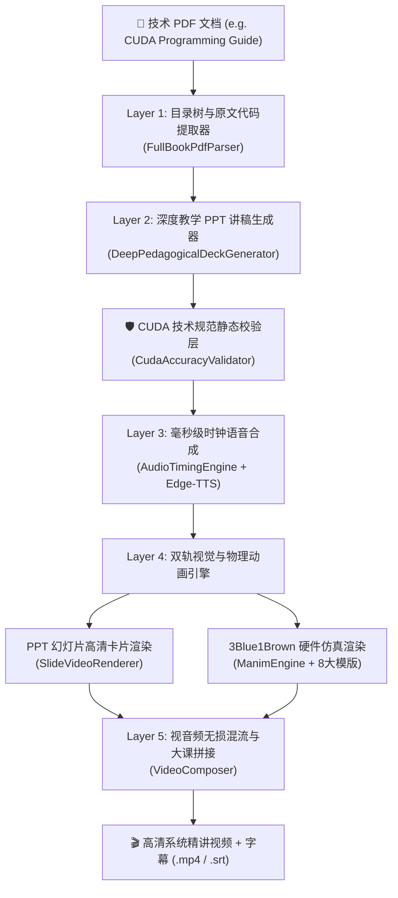

# CudaStudy: Technical PDF to High-Density Video Studio

> **Transform Complex System Technical Documentation (e.g., CUDA C++ Programming Guide) into Structured Pedagogical Lecture Slide Decks & 3Blue1Brown-style Manim Hardware Microarchitecture Simulations.**

---

## ✅ v2 实现说明（以代码为准）

当前实现已改为「**DeepSeek 主导讲稿与分镜 → 确定性 Manim 渲染器执行**」：

1. **DeepSeek 真正接管 PPT 与动画设计**
   - `pipeline/l2_deep_deck.py` 用 DeepSeek 生成每一节的 PPT 讲稿，并**为每一页单独产出 `scene_plan`**（图形类型、步骤、高亮元素、时长）。
   - 模型不再直接写 Python 代码执行，而是输出受约束的 JSON 分镜；`assets/storyboard_scene.py` 负责把它渲染成 6 种图形（grid / bars / timeline / boxes / code / compare），因此**每一页动画都不一样**。
   - 未配置 Key 时**直接报错并停止**，不会生成模板/兜底讲稿（v2.2 起移除了无 Key 兜底模式）。

2. **字幕永不遮挡画面**
   - 成片固定 `1280x720`：上方 `1280x632` 为内容区，底部 `88px` 为专用字幕条带。
   - 所有片段先归一化（scale/pad/30fps/AAC），字幕只烧进底部条带；同时保留 `.srt` 文件。

3. **Key 的生效路径已打通**
   - `config.api_key()` 是唯一入口；GUI 输入框、`.env`、环境变量三种方式都生效。
   - 代码生成、讲稿生成、体检全部使用同一个客户端 `pipeline/deepseek_client.py`（带重试、超时、JSON 容错，日志只打印 Key 指纹）。

4. **关键修复**
   - 修复 PDF 代码抽取（此前对真实文档恒返回 0 段代码）。
   - 修复「成片结束但状态显示成功」、GUI 体检按钮 `NameError`、打包后 Manim 解释器自指等阻断问题。
   - 分页缓存改为内容哈希（改稿/换画质不会误复用旧片段）。

5. **打包（CudaVideoStudio.exe）**
   - 构建：`.venv\Scripts\python.exe build_exe.py`（onefile / windowed，约 94MB）。
   - GUI 依赖（customtkinter / av / pypdf / edge-tts / requests）已打进 exe；**Manim 不进包**，渲染时调用同目录 `.venv\Scripts\python.exe -m manim`。
   - 因此 exe 必须与 `.venv/`、`assets/`、默认 PDF 放在同一目录（即项目根目录）；单独把 exe 复制到桌面无法渲染。
   - 无控制台排查：运行 `CudaVideoStudio.exe --selftest`，结果写入 `output/_selftest.txt`。

6. **v2.1 视觉引擎（概念专用动画）**
   - 不再只有通用方框：新增 `warp`（32 线程锁步/分支分化）、`banks`（32 Bank 冲突/Padding）、`coalesce`（合并访存/事务分裂）、`matrix`（Tiled GEMM）等概念专用分镜。
   - 高对比度主题：白色正文 + 高饱和强调色 + 抬升的舞台面板，不再是"95% 像素接近纯黑"。
   - 每个分镜包含：大标题、左侧要点、关键数字（32 / 128B / TILE）、底部阶段进度、扫描光带与呼吸高亮，避免长时间定格。
   - **字幕与高亮共用同一套分步时间窗**：旁白按步骤切分后，步骤起始时刻 = 对应字幕 cue 的起始时刻；`code` 分镜直接使用 LLM 给出的 `focus` 行号高亮，不再用“第几步”猜行号。
   - **每步独立旁白与配音**：DeepSeek 为每个 step 单独产出 `narration`（60~140 字），L3 逐步合成语音并拼接；该步音频时长就是动画窗口，窗口内字幕只来自该步旁白。`code` 步骤的旁白只讲 `focus` 指定的代码行，并在校验阶段按旁白中的标识符自动修正 focus。
   - **反重复与内容质量**：语料输入扩展到 18 段原文 + 4 段真实代码；输出后自动剔除跨页完全重复的句子，近重复讲解或跨页复用同一段代码则带具体原因重写；提示词要求每页按“是什么 → 为什么 → 原文例子 → 边界/性能”展开。
   - **长输出防截断**：默认生成 4 页 × 3 步的紧凑分镜，避免 8K token 截断；若 JSON 仍被截断，会先尝试修复并只保留完整页，再用更紧凑的提示重试。
   - **总结页也动画**：summary 页只要带有效 `scene_plan` 就走 Manim，不再强制降级成静态卡片。
   - **TTS 符号规范化**：`kernel<<<grid, block>>>` 读作“启动配置为 …”，`__syncthreads()` 读作“同步屏障”，`blockIdx.x` 读作“块索引变量的 x 分量”，不再把 `<<<` 念成一串“小于”。
   - **剧集路由**：按概念而非泛词（GPU/CUDA）匹配章节，`ep_09 线程索引` 已从误匹配的 Multi-GPU 章节改到 Programming Model。
   - **字幕强制单行**：先按标点/空格/英文整词切成语义单元，再组合成不超过约 28em 的单行字幕；烧录字号 20、`WrapStyle=2`，不会折成两行，也不会切断英文标识符或中文词组。
   - DeepSeek 的提示词已升级：要求为每页选择概念专用 `kind`、4~5 个中文步骤、每步解释因果；模型选错通用图形时会被自动升级为匹配的专用图形。
   - 剧集（`ep_XX`）不再使用硬编码页码，而是按标题语义匹配真实 PDF 章节（如 `ep_06 Warp/SIMT → Writing SIMT Kernels`），避免内容错位。


## 🌟 核心特性 (Key Features)

1. **全书目录树与原文字节解析 (L1 Full-Book Dynamic Parser)**:
   - 动态递归提取 PDF 内部目录大纲（TOC）、章节层级、精确页码范围。
   - 自动消除双栏排版断行断字、去除页眉页脚干扰，智能提取原版 C++/CUDA 代码块与数学公式。

2. **深层教学型 PPT 讲稿生成 (L2 Deep Pedagogical Deck Generator)**:
   - 告别空洞泛化，依据原文真实篇幅动态生成 4 至 12 页的高信息密度 PPT（提供 Markdown 与 HTML 演示文稿预览）。
   - 每页均配备 150~300 字详尽、严密的教学级口播讲稿，并内置 **3.5 秒认知消化停顿** 机制。

3. **CUDA 技术准确性静态校验层 (CUDA Accuracy Validator)**:
   - 内置针对并发和异构计算的规则分析器：自动拦截分支内的 `__syncthreads()` 死锁隐患、全局内存索引越界、Shared Memory Bank 冲突跨步，保证讲稿与代码 100% 严谨可靠。

4. **多模态技术表现力矩阵 (Multi-Modal Visualization Suite)**:
   - 除了 3Blue1Brown 几何动画，系统全面集成了 **6 大认知维度的全方位表现手段**：
     - 💡 **白板心智模型比喻 (Metaphor Sketch)**：通过生活物理类比瞬间破除冰冷抽象；
     - 🎬 **Manim 硬件物理仿真 (Microarchitecture Simulation)**：推演纳秒级时钟周期内的总线与线程冲突；
     - ⚖️ **代码双分屏 Diff 对照 (Side-by-Side Code Diff)**：红框朴素反例 vs 绿框生产规范，行号与高亮一目了然；
     - ⏱️ **Nsight Systems 真实时序 Trace (Profiler Timeline)**：直观展现 Stream 异步流水线与 PCIe 算力 100% 重叠；
     - 🗄️ **32-Bank 物理显存排布 (Memory Layout Grid)**：可视化并发访问冲突探测与 Padding 对角消除；
     - 📊 **实测性能加速比柱状图 (Empirical Benchmark Chart)**：以硬核实测数字证明重构带来的数倍算力飞跃。


5. **断点续跑与秒级恢复 (Checkpoint Resume & Caching)**:
   - 每一层中间产物（Deck JSON、音频、分段视频切片）全部结构化落盘。
   - 遇到网络中断或重新生成时，自动秒级跳过已渲染素材，仅生成失败或缺失的切片。

6. **开箱即用图形化控制台 (app_gui.py / CudaVideoStudio.exe)**:
   - 基于 CustomTkinter 打造的现代化深色界面，内置一键环境体检诊断工具、画质切换、音色定制与实时日志流。

---

## 🏛️ 五层架构流水线 (Pipeline Architecture)



---

## 🎬 内置 8 大 CUDA 硬件级 Manim 仿真模版

| 编号 | 仿真主题 | 核心展示的软硬件冲突与解法 |
| :---: | :--- | :--- |
| **01** | **Global Thread Indexing** | CPU 串行线性思维 vs GPU 块与线程网格空间升维映射 (`blockIdx * blockDim + threadIdx`) |
| **02** | **Warp Divergence** | SIMT 32 线程束锁步推进 vs `if/else` 分支硬件强制串行掩码挂起 |
| **03** | **Shared Memory Bank Conflict** | 32 路 Bank 并发访问 vs 2路/多路命中同一 Bank 导致排队降速（含 Padding 对角填充解法） |
| **04** | **Coalesced Memory Access** | 128 字节总线事务对齐合并访存 vs 离散跨步访问导致的带宽暴跌（AoS 转 SoA） |
| **05** | **Atomic Operations & Race** | 多线程并发读改写导致的全局累加器数据丢失 vs 硬件互斥锁与局部规约 |
| **06** | **__syncthreads() Barrier Safety** | 块内乱序脏读防范 vs 分支内屏障导致硬件永久死锁禁忌 |
| **07** | **Tiled GEMM Matrix Multiplication** | 全局显存高延迟搬运瓶颈 vs 片上 Shared Memory 协作复用数十倍算力 |
| **08** | **CUDA Streams & Overlap** | 默认流串行阻塞 vs 多流双缓冲异步流水线（PCIe 传输与 SM 算力 100% 重叠） |

---

## 🎨 全栈多模态技术阐述矩阵 (Beyond Manim)

为了让技术讲解不流于表面或单一枯燥，系统为每一个核心技术专题配备了完整的认知闭环：

```text
[1. 痛点与背景] ────► [2. 白板生活比喻] ────► [3. Manim 物理仿真]
        │                      │                       │
        ▼                      ▼                       ▼
架构全景与文档定位        考场做卷 / 银行柜台       芯片微架构空间博弈
        │                      │                       │
        └──────────────────────┼───────────────────────┘
                               │
                               ▼
[4. 代码 Diff 对照] ──► [5. Nsight 真实 Trace] ──► [6. 实测加速比柱状图] ──► [7. 认知沉淀清单]
        │                      │                       │                      │
        ▼                      ▼                       ▼                      ▼
  红框反例 vs 绿框规范     流水线气泡与传输重叠         8.5x 硬核性能跃升        工业级避坑自查心法
```

| 模态手段 | 表现形式与技术承载 | 解决的技术阐述痛点 |
| :--- | :--- | :--- |
| **💡 白板生活比喻 (Metaphor)** | 类似 Excalidraw 的黑板手写卡片与生动类比 | 击碎体系结构冷冰冰的抽象术语，建立直观的第一性原理直觉 |
| **🎬 3Blue1Brown 物理推演** | Manim Community 连续几何动力学矢量动画 | 还原微架构黑盒中线程阵列、总线事务与时钟周期的连续空间博弈 |
| **⚖️ 左右分屏代码 Diff 对照** | 双栏高对比度语法高亮与行号卡片 (Red vs Green) | 解决“懂了原理却不会写代码”的痛点，直观对比反例漏洞与生产标准 |
| **⏱️ Nsight Systems 追踪** | 真实 GPU Profiler 风格的时间线 (Trace Timeline) | 走出抽象代码，从分析器视角审视 Kernel 调度、气泡等待与多流重叠 |
| **🗄️ 32-Bank 物理分布网格** | 显存空间槽位与线程访问映射图 | 精确指出具体哪两个线程在哪个字节槽位撞车，Padding 如何错开 |
| **📊 实测加速比柱状图** | 现代暗黑风格的 Benchmark 对比柱状图 + 跃升徽章 | 用硬核的 GFLOPS / 带宽实测数字说话，杜绝无依据的口头空谈 |
| **🧠 认知反思缓冲条** | 底部蓝色高光认知沉淀条 (Schema Consolidation) | 预留 3.5 秒心理消化时间，避免知识密度过大引发的认知超载 |


---

## 🛠️ 运行环境要求与一键体检

### 1. 基础环境
- **Python**: 3.10 或 3.11（推荐 3.11）
- **FFmpeg**: 必备视频编解码工具（项目内置自动挂载机制）
- **Edge-TTS**: 微软原生高清语音合成（无需任何付费 Key）
- **DeepSeek API Key（必需）**：讲稿与 Manim 分镜完全由 DeepSeek 生成；未配置时程序会明确报错，不再生成本地兜底内容。

### 2. 一键自检运行环境
在终端中执行内置的诊断脚本：
```bash
python check_env.py
```
若全部就绪，将输出如下诊断报告：
```text
===========================================================================
🚀 [CudaStudy Video Studio] 系统与运行环境诊断报告
===========================================================================
✅ [通过]   Python 解释器版本              : Python 3.11.6
✅ [通过]   FFmpeg 视频编解码器             : 就绪 -> ffmpeg.exe (v9.0.2)
✅ [通过]   Manim 物理动画引擎              : Manim Community v0.22.1
✅ [通过]   Edge-TTS 语音合成库            : edge-tts 正常加载 (zh-CN-YunxiNeural)
✅ [通过]   CUDA 官方教材 PDF             : cuda-programming-guide.pdf (11.66 MB)
===========================================================================
🎉 核心环境完备！系统随时可以启动生成课程视频。
===========================================================================
```

---

## 🚀 快速起步

### 1. 克隆与安装依赖
```bash
git clone https://github.com/maleRjc/CudaStudy.git
cd CudaStudy

# 创建并激活虚拟环境
python -m venv .venv
.venv\Scripts\activate

# 安装完整依赖（此前 README 遗漏了 pypdf/av/Pillow 等）
pip install -r requirements.txt

# 配置 DeepSeek（必需）
copy .env.example .env
# 编辑 .env 填入 DEEPSEEK_API_KEY=sk-...
```

> 也可以在 GUI 输入框里填一次并保持勾选「记住 Key」：验证通过（或点击生成）后会自动写入项目根目录 `.env`，下次启动自动填入。`.env` 已被 git 忽略。

### 2. 启动桌面可视化控制台
```bash
python app_gui.py
```
在控制台中：
1. 点击 **"🔍 运行系统依赖体检"** 确认环境完整；
2. 选择要生成的章节切片（如 `01_global_thread_indexing` 或全书任意章节）；
3. 勾选 **"启用断点续跑"**；
4. 点击 **"🚀 一键生成 PPT 讲稿与精讲视频"**，即可自动产出 Markdown 幻灯片、HTML 网页课件及最终 MP4 视频！

### 3. 命令行静默批处理
```bash
# 生成第 2 节（1-based 目录序号），--force 忽略断点
python pipeline/full_book_orchestrator.py --section 2 --limit 1

# 按课程大纲重做第 6 讲（自动匹配真实 PDF 章节）
python pipeline/full_book_orchestrator.py --episode 6 --force --max-slides 5

# 校验规则自测
python pipeline/cuda_validator.py

# 运行契约测试（不需要 API Key / 不联网）
python -m unittest discover -s tests -v
```

> Windows 控制台若为 GBK，建议先 `set PYTHONUTF8=1`，避免 emoji 日志在重定向时触发编码错误。


---

## ❓ 常见问题排查 (FAQ)

### Q1: FFmpeg 报错 `ffmpeg not found`？
- **解答**：安装 `imageio-ffmpeg`（`pip install imageio-ffmpeg`），系统已内置自动探测逻辑，无需手动配置 Windows 环境变量即可自动挂载。

### Q2: Manim 报错 `LaTeX not found` 或公式渲染异常？
- **解答**：v2 的 Storyboard 渲染器不使用 `MathTex`/LaTeX，公式以 Unicode 文本与几何图形表达，因此不依赖 MiKTeX。若你自己扩展了 `assets/storyboard_scene.py` 并引入 `MathTex`，仍需安装 LaTeX。

### Q3: 运行中断后需要从头开始吗？
- **解答**：不需要。分页片段按「分镜内容哈希 + 时长 + 画质」命名缓存，重跑时自动复用；讲稿变化时旧片段会自然失效，不会出现“改了脚本还是旧视频”。


---

## 📄 授权协议
本项目遵循 [MIT License](LICENSE)。欢迎提交 Issue 与 Pull Request！
